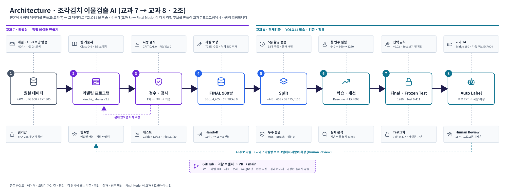

# AI Model Development — Kimchi Foreign Object Detection

> Team project · 6 members · Vision AI & Vertical AI Convergence Course (Oct 2026)
> **Project Manager (PM): Sung Hyung Lee**

Two connected projects that build a foreign-object detector for cut kimchi (*kkakdugi / jogak-kimchi*) on a production line:

| Folder | Stage | What it is |
|---|---|---|
| [`project7/`](project7/README.md) | **Data labeling** | `kimchi_labeler` — a Tkinter labeling tool built from scratch. 900 images fully re-reviewed by 6 people to create a trustworthy ground-truth set (FINAL 900 pairs). |
| [`project8/`](project8/README.md) | **Model** | YOLO11 training → failure analysis → one-variable experiments → Final Model → Frozen Test (once) → Auto Label back into the project7 tool for Human Review. |

The provided labels had many wrong and missing boxes, so we fixed the data first (project7) and only then trained and evaluated the model (project8). The guiding rule for both: **a reliable evaluation over a high score**.



<br>

## Results

| Area | Result |
|---|---|
| Labeling | 900 / 900 images reviewed in 3 rounds · **778 images (86%) corrected** · 2,383 boxes fixed · 350 missing objects added · automatic check CRITICAL **0** |
| Class rule | Rubber gloves defined as **background** (not a foreign object) → removed mislabeled "plastic" boxes (1,831 → 1,665) |
| Data split | Split by **5-minute capture group** (18 groups, none split): Train 609 · Val 66 · Test 75 · Bridge 150 |
| Leakage check | Baseline Recall 0.781 (image-level split, leaked) → **0.444** (group-level split, honest) — all models retrained |
| Model | Baseline yolo11n · 640 mAP50-95 **0.345** → Final **EXP003** yolo11n · 1280 **0.446 (+29%)** |
| Frozen Test | Evaluated **once**, after the Final Model was fixed · mAP50-95 **0.4115** (75 images) |
| Speed | ~26 GFLOPs · **8.7 ms / image** on RTX 3060 |
| Auto Label | Model proposes boxes → human confirms in the project7 tool (demo: 3 candidates → 4 confirmed, 1 class fix, 1 added) |

**Known limits** — disease/browning recall 0 (data concentrated in one capture group → re-shoot planned), ~60% of small objects still missed, 1280 input costs ~4× compute (edge-device speed to be checked).

<br>

## My Role — Project Manager (Sung Hyung Lee)

| | What I did |
|---|---|
| Problem definition | Found the wrong / missing labels in the provided data and set the direction: rebuild the ground truth before training. Decided the "rubber glove = background" class rule. |
| Leakage & split | Identified that the image-level split leaked the same capture group into Train and Val (Recall 0.781 was inflated); moved to a capture-group split (v4-B) and had every model retrained. |
| Evaluation rules | Fixed the adoption criterion (mAP50-95 +0.02) **before** seeing results, one variable per experiment, Frozen Test only once — and enforced them in code (training stops if 2+ variables change; Test evaluation is locked without `allow_test=True`). |
| FINAL dataset | Ran the FINAL build gate (CRITICAL 0 · REVIEW 0 · RAW unchanged) and handed the 900 pairs to the model stage. |
| GitHub | Role branches → PR → `main`; reviewed and merged the team's PRs (#1 – #81); security rules (no raw photos in Git, no `git add .`). |
| Docs & presentation | README, architecture, user manual, issue → fix report, code review; final presentation (13 slides + 12 appendix slides). |

Team roles: PM · GUI / Experiment · Coord / Evaluation · Storage / Training · QA / Data · Manifest / Inference (project7 / project8).

<br>

## Folder Structure

```text
AI-Model-Development/
├── README.md                 ← this file
├── project7/                 ← labeling tool kimchi_labeler (Python · Tkinter)
│   ├── main.py · src/ · scripts/ · tests/
│   └── docs/ · reports/ · manifests/
├── project8/                 ← YOLO11 detection (Ultralytics · PyTorch)
│   ├── src/ · scripts/ (01 – 15) · tests/
│   ├── models/               ← trained weights (baseline · exp001–004 · final)
│   └── reports/ · manifests/ · docs/
└── docs/
    ├── architecture/         ← overall · project7 · project8 diagrams
    ├── presentation/         ← final presentation (PDF)
    └── figma/                ← Figma boards exported as images
```

## Documents

| Document | File |
|---|---|
| Final presentation (13 slides + appendix) | [docs/presentation](docs/presentation/Team2_Kimchi_Foreign_Object_Detection_Presentation.pdf) |
| Architecture diagrams | [docs/architecture](docs/architecture) |
| Figma boards (UI history, role board, data audit, split) | [docs/figma](docs/figma/README.md) |
| Labeling tool details | [project7/README.md](project7/README.md) |
| Detection model details | [project8/README.md](project8/README.md) |

## Tech Stack

Python · Tkinter · OpenCV · Pandas · Ultralytics YOLO11 · PyTorch (CUDA) · pytest · Git / GitHub · WSL2 · Figma

## Data Notice

- The dataset is **100% synthetic** data provided for education by AI Campus and is under **NDA**. Original images are **not** included in this repository.
- Every screenshot or slide that shows a kimchi photo has been **blurred**. Label TXT / CSV files, metrics, and weights are included.
- Project READMEs inside `project7/` and `project8/` are written in Korean (original team documents).
